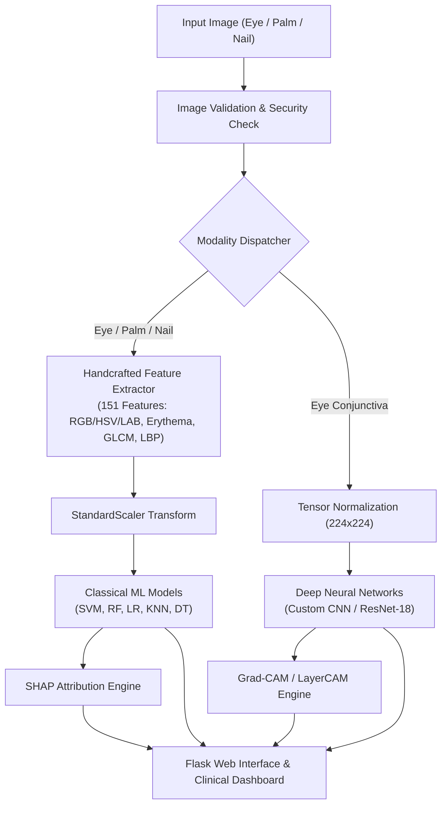

# AI-Based Anemia Detection Using Image Processing, Machine Learning, Deep Learning, and Explainable AI

[](https://www.python.org/)
[](https://palletsprojects.com/p/flask/)
[](https://pytorch.org/)
[](https://scikit-learn.org/)
[](LICENSE)

> **Research Notice & Medical Disclaimer**  
> This software is an academic engineering research prototype developed for image processing and computer vision model benchmarking. It is not certified, cleared, or approved as a medical device for clinical diagnosis. Clinical diagnosis of anemia requires standard venous complete blood count (CBC) hemoglobin laboratory evaluation under certified healthcare oversight.

---

## Overview

This project provides an automated non-invasive screening prototype that evaluates peripheral tissue pallor across three anatomical regions:
- **Eye Conjunctiva** (palpebral mucosa)
- **Palmar Pallor** (palm skin and palmar creases)
- **Nail Beds** (subungual vascular beds)

The system integrates end-to-end data processing, feature engineering, classical machine learning classifiers, deep learning architectures, post-hoc explainability, and an interactive Flask web application.

---

## Key Features

- **Multi-Modal Image Evaluation:** Supports conjunctiva, palm, and nail bed inputs with modality-specific routing.
- **17 Trained Models:**
  - *Deep Learning (2 models):* Pretrained ResNet-18 and Custom 4-Block CNN on eye conjunctiva.
  - *Classical ML (15 models):* Support Vector Machine, Random Forest, Logistic Regression, KNN ($k=15$), and Decision Tree across all 3 modalities.
- **Explainable AI (XAI):**
  - *Deep Learning:* 4-panel visual saliency maps (Grad-CAM, LayerCAM, Guided Backpropagation, Guided Grad-CAM).
  - *Classical ML:* SHAP waterfall plots and top-contributing feature tables.
- **Clinical Benchmark Dashboard:** Interactive display of test performance metrics (Accuracy, Balanced Accuracy, Precision, Recall, Specificity, F1-Score, ROC-AUC, MCC) evaluated on an isolated holdout partition ($N=1,117$).
- **Responsive Web Interface:** Flask web app supporting drag-and-drop upload, image validation, dynamic model selection, and real-time inference.

---

## System Architecture



---

## 7-Phase Research Lifecycle

1. **Phase 1: Dataset Inspection & Extraction:** Quality audit and metadata extraction across raw image collections.
2. **Phase 2: Cleaning & Stratified Splitting:** Verification of labels and creation of patient-stratified 70:15:15 partitions (`train.csv`, `validation.csv`, `test.csv`).
3. **Phase 3: Classical Machine Learning:** Extraction of 151 color and texture features; training of 15 scikit-learn models.
4. **Phase 4: Deep Learning:** Implementation and training of Custom CNN and transfer-learned ResNet-18.
5. **Phase 5: Independent Evaluation:** Comprehensive evaluation of all 17 models on the isolated test partition ($N=1,117$).
6. **Phase 6: Explainable AI & Optimization:** Saliency mapping with Grad-CAM/LayerCAM and SHAP attribution with sampling optimizations.
7. **Phase 7: Flask Web Application:** Full-stack deployment with interactive inference, model comparison, dashboard views, and test suites.

---

## Datasets

### 1. dataset_cleaned.zip

**Collected and preprocessed by:** [Shreenisha-S30](https://github.com/Shreenisha-S30)

### 2. Palm_preprocessed.zip

**Collected by:** [Shreenisha-S30](https://github.com/Shreenisha-S30)

**Preprocessed by:** [thejuthejaskg-lab](https://github.com/thejuthejaskg-lab)

Due to patient privacy considerations and repository file size limits, dataset archives and raw image directories are excluded from version control.

To configure the data locally:
1. Place `dataset_cleaned.zip` and `Palm_preprocessed.zip` into the `datasets/` directory.
2. Execute the extraction and preprocessing scripts located in `scripts/`.

---

## Installation & Usage

### Prerequisites
- Python 3.10+ (tested on Python 3.14)
- Git

### Setup
```powershell
# Clone the repository
git clone https://github.com/LikithaC17/anemia-detection.git
cd anemia-detection

# Create and activate a virtual environment
python -m venv venv
.\venv\Scripts\Activate.ps1

# Install required dependencies
pip install -r requirements.txt
```

### Running the Web Application
```powershell
python app.py
```
Access the application locally at: `http://127.0.0.1:5001/`

### Running the Tests
```powershell
python -m pytest tests/ -v
```

---

## Contributors

| GitHub account | Credit |
|---|---|
| [LikithaC17](https://github.com/LikithaC17) | Core project author, first contributor to push the project implementation, system architect, Phases 3–7 implementation (Phase 3: Classical ML & feature extraction; Phase 4: CNN & ResNet-18; Phase 5: Model evaluation & metrics; Phase 6: SHAP & Grad-CAM XAI; Phase 7: Flask web application), ML/DL pipelines, model evaluation, XAI integration, and Flask application development. |
| [Shreenisha-S30](https://github.com/Shreenisha-S30) | Collection of both datasets and preprocessing of `dataset_cleaned.zip`. |
| [thejuthejaskg-lab](https://github.com/thejuthejaskg-lab) | Preprocessing of `Palm_preprocessed.zip`. |
| [SrivatsaKulkarni1](https://github.com/SrivatsaKulkarni1) | |

---

## License

This project is open-source under the [MIT License](LICENSE).
